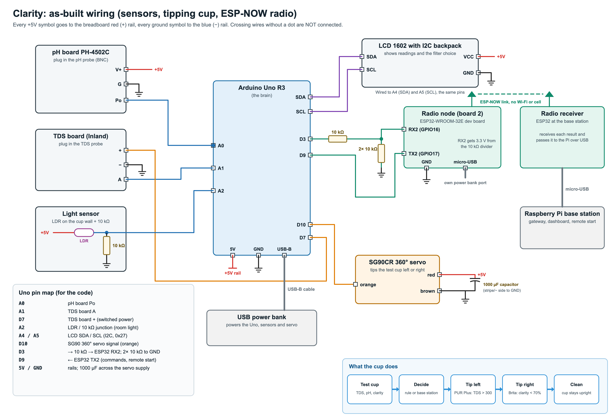
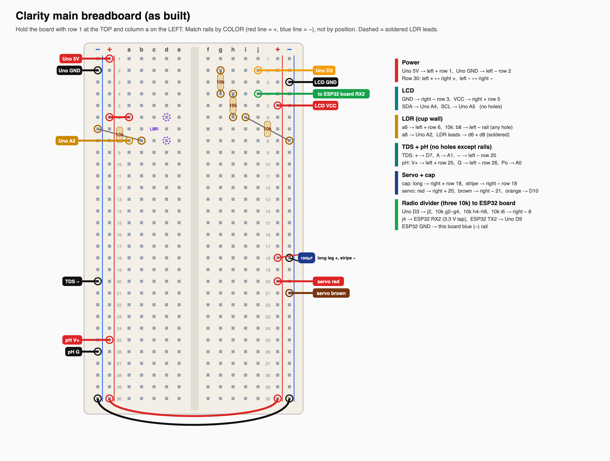
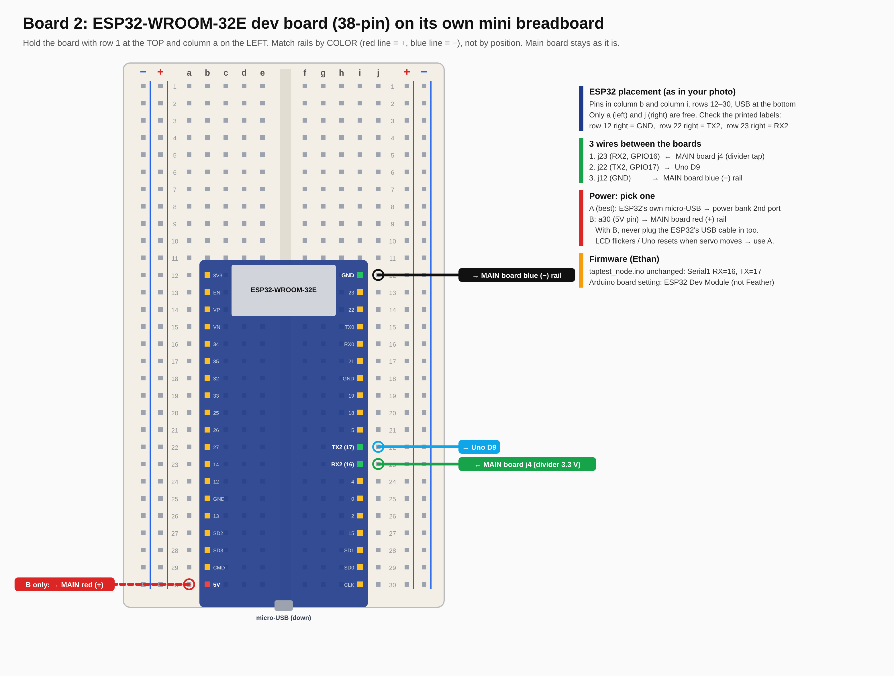
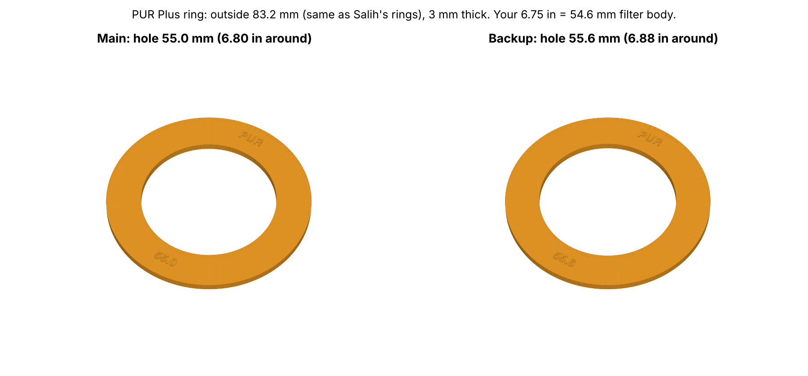

# Clarity hardware

Clarity is a water tester you pour into. One cup of water goes into the test cup, the tank measures
dissolved solids (TDS), pH and clarity, shows the result on its screen, and then tips the cup into the
filter that fixes the problem: left into a PUR Plus filter for high dissolved solids, right into a Brita
for cloudy water. Water that reads in range stays where it is. Every reading goes out over a direct
ESP-NOW radio link to the Raspberry Pi base station, and the base station can start a test over the same link.

This folder documents the tank as it was built: wiring, the two boards, the parts, and the printed PUR Plus ring.
The firmware lives in [`../firmware`](../firmware).



*Full schematic. SVG version: [`diagrams/clarity-wiring.svg`](diagrams/clarity-wiring.svg).*

## How it works

```
 test cup ── TDS probe ──┐
          ── pH probe  ──┼──> Arduino Uno ──> 1602 LCD (readings, filter choice)
          ── LDR       ──┘        │
                                  ├──> SG90 360° servo: tip left (PUR Plus), tip right (Brita), or stay upright
                                  │
                         D3 / D9 serial (D3 through a 3.3 V divider)
                                  │
                       ESP32 radio node (board 2)
                                  │  ESP-NOW, no Wi-Fi or cell
                       ESP32 receiver ──USB──> Raspberry Pi base station
```

1. Water is poured into the test cup. The TDS and pH probes sit in the cup, and a light sensor (LDR)
   on the cup wall reads room light coming through the water.
2. The Uno reads all three, then decides:
   - TDS above 300 ppm: tip **left** into **PUR Plus**.
   - Otherwise, clarity below 70%: tip **right** into **Brita**.
   - Otherwise the cup stays **upright**.
3. Clear-cut readings are acted on at once. Borderline ones (within 45 ppm of the TDS limit, within
   8 points of the clarity limit, both problems at once, or a reading that looks like a sensor fault)
   are sent to the base station, which answers within 8 seconds; if it does not, the Uno uses its own rule.
4. The servo tips the cup, holds it for 4 seconds while the water pours out, and brings it back upright.
5. The filtered water can be poured back in for a retest, so each pour has a before and an after reading.

## Parts

| Part | Role |
|---|---|
| Arduino Uno R3 | Reads the sensors, decides, drives the LCD and servo |
| Inland TDS sensor board + probe | Dissolved solids, powered from D7 so it only runs while measuring |
| PH-4502C pH board + probe | pH (analog out to A0) |
| LDR + 10 kΩ resistor | Clarity: room light through the cup, as a voltage divider into A2 |
| 1602 LCD with I2C backpack (0x27) | Shows readings and the filter choice |
| SG90 360° continuous servo | Tips the test cup left or right |
| 1000 µF electrolytic capacitor | Across the servo supply, so the Uno and LCD do not brown out when it starts |
| ESP32-WROOM-32E dev board (38-pin) | Radio node on its own mini breadboard: serial to ESP-NOW |
| ESP32 board at the base station | Radio receiver, plugged into the Pi by USB |
| Raspberry Pi | Base station: runs the gateway and the dashboard |
| 3 × 10 kΩ resistors | Divider that brings the Uno's 5 V serial down to 3.3 V for the ESP32 |
| 2 breadboards, USB power bank | Main board and the ESP32 board; power for the Uno and the ESP32 |
| PUR Plus filter, Brita filter | The two filters the cup tips into |

## Uno pin map

| Uno pin | Connected to |
|---|---|
| A0 | pH board Po |
| A1 | TDS board A (signal) |
| D7 | TDS board + (switched power) |
| A2 | LDR / 10 kΩ junction |
| A4 / A5 | LCD SDA / SCL |
| D10 | Servo signal (orange) |
| D3 | Through 10 kΩ to ESP32 RX2 (GPIO16); 2 × 10 kΩ from that point to GND |
| D9 | From ESP32 TX2 (GPIO17) |
| 5V / GND | Breadboard rails; LCD, sensors and servo run from these |

## Main breadboard (as built)



- The two rails are bridged at row 30, so both sides carry 5 V and ground.
- The LDR leads are soldered to wires and taped to the cup wall; the 10 kΩ pulldown is on the board.
- The TDS and pH boards connect straight to the rails and the Uno pins, with no breadboard holes in between.
- The 1000 µF capacitor sits across the rails at row 18, right by the servo's power at rows 20 and 21
  (long leg to +, striped leg to −).

### Radio divider

The Uno talks 5 V serial and the ESP32's RX2 pin takes 3.3 V. Three 10 kΩ resistors in series from D3
to ground make the tap point read 5 V × 20k / 30k ≈ 3.3 V. The ESP32's TX2 already outputs 3.3 V, which
the Uno reads as a logic high, so D9 is wired directly. The two boards share ground.

## Board 2: ESP32 radio node



The ESP32 sits on its own mini breadboard, joined to the main board by three wires: RX2 from the
divider tap, TX2 to Uno D9, and GND to the main board's ground rail. It runs from its own micro-USB
port on the power bank, which keeps servo current spikes away from the radio (its 5V pin to the main
board's + rail also works, as long as its USB cable is not plugged in at the same time).

## Radio link and remote start

- The Uno sends each result as one line of JSON at 9600 baud; the ESP32 node broadcasts every line
  over ESP-NOW, and the receiver ESP32 at the base station prints it over USB to the Pi.
- Commands go the other way on the same path. The Pi can send the filter choice for a borderline
  reading, or `{"cmd":"run"}` to start a test remotely; the Uno treats a remote start exactly like a local one.
  On the gateway, `POST /api/start` sends that command (it is guarded the same way as the other control routes).
- On the radio the PUR Plus side is still labelled `ZEROWATER`, the name of the filter that side was
  first designed for, so the gateway and dashboard read it without changes. The tank's own screen says PUR Plus.

## Firmware

| Sketch | Board | What it does |
|---|---|---|
| [`firmware/taptest_uno`](../firmware/taptest_uno/taptest_uno.ino) | Arduino Uno | Sensors, decision rule, tipping cup, LCD, radio out, remote start |
| [`firmware/taptest_node`](../firmware/taptest_node/taptest_node.ino) | ESP32 radio node (Arduino board setting "ESP32 Dev Module") | UART on GPIO16 / GPIO17 at 9600 baud to ESP-NOW and back |
| [`firmware/taptest_receiver`](../firmware/taptest_receiver/taptest_receiver.ino) | ESP32 at the base station | ESP-NOW to USB serial and back |

The Uno sketch needs the "LiquidCrystal I2C" library (Frank de Brabander); Servo, Wire, EEPROM and
SoftwareSerial come with the Arduino IDE. The ESP32 sketches need the "esp32 by Espressif" board package.

pH is wired and read on A0. For the demo the sketch estimates pH from TDS (`PH_FROM_TDS 1`), because
the probe drifts without buffer calibration; setting it to 0 switches back to the probe reading.

### Calibration console

Open the Serial Monitor at 115200 baud and type `h` for the list. The ones used during the build:

| Command | Does |
|---|---|
| `v` | Raw values: pH volts, TDS ppm, clarity reading |
| `m` | A full measurement: pH, TDS, clarity |
| `c` | Saves the current clarity reading as clean water (pour clean water in first) |
| `s1500` | Sets the servo's stop pulse; nudge it (1490, 1510...) until the servo does not creep |
| `p1000` | Tip time in ms, which sets how far the cup tilts |
| `k1.0` | Return scale, so the cup comes back fully upright |
| `L` / `R` | A full tip left / right |
| `g` | Runs a test |

Calibration is stored in EEPROM, so it survives a power cycle.

## Printed part: PUR Plus ring



The PUR Plus filter is held in the stand cup by a printed ring: 83.2 mm outside, so it sits on the
cup's 84 mm ledge, and 3 mm thick. The filter body measures 54.6 mm across; the main ring's hole is
55.0 mm for a snug fit that also seals, with a 55.6 mm backup. Print in PLA, flat, 0.2 mm layers,
20% infill, no supports, about 10 minutes each.

Files in [`cad/pur-ring`](cad/pur-ring): STL and STEP for both sizes, and `ring.py` (CadQuery) to regenerate them.

## Regenerating the diagrams

The wiring images are drawn by the scripts in [`diagrams/src`](diagrams/src): each writes an SVG
(or an HTML page holding one) that can be opened in a browser and saved as PNG.
